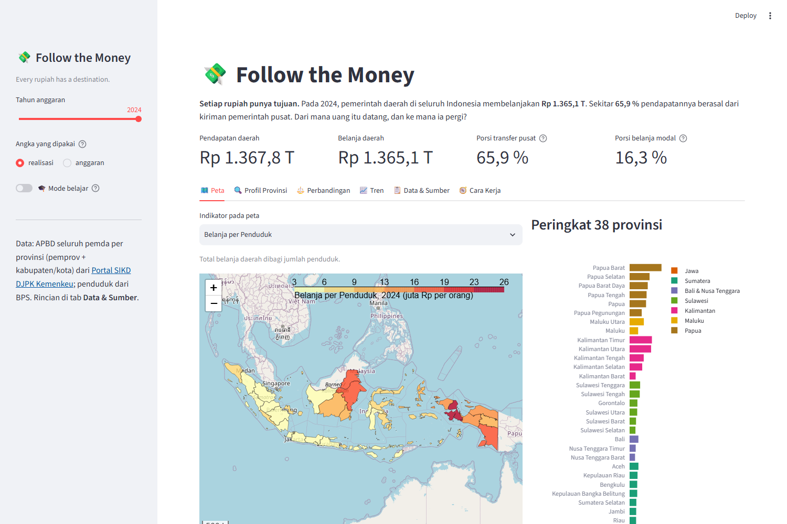
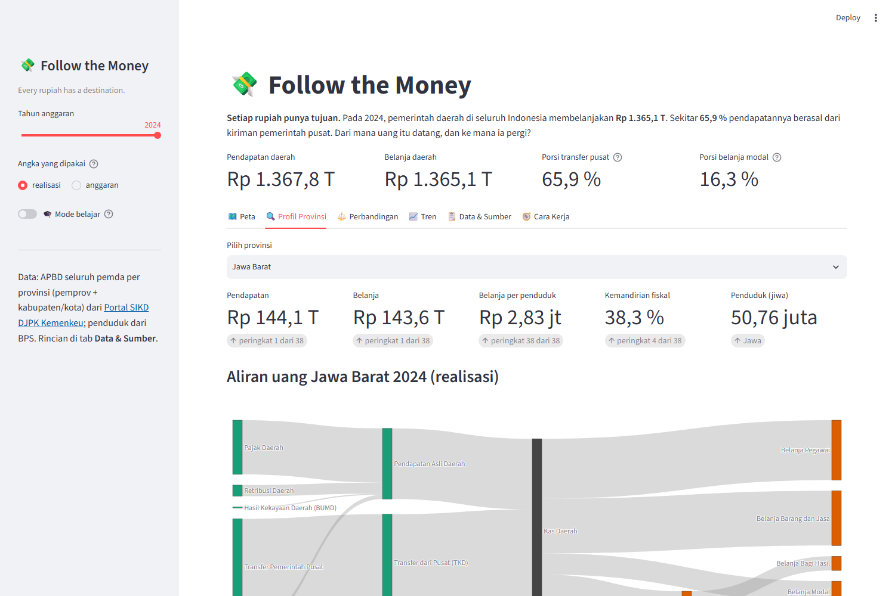
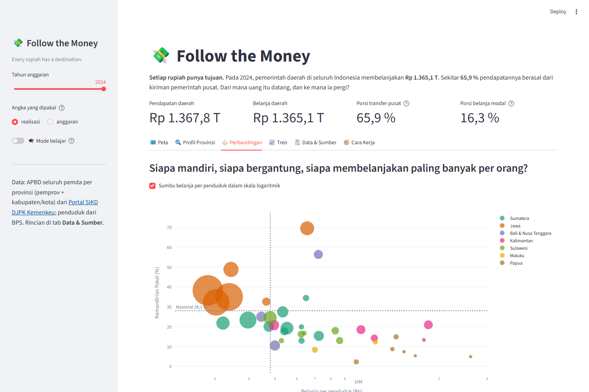

# 💸 Follow the Money

> **Setiap rupiah punya tujuan.** Dasbor interaktif untuk menelusuri **APBD 38 provinsi** Indonesia:
> dari mana uang daerah datang (pajak sendiri atau kiriman pusat), ke mana ia pergi (gaji, barang, atau
> pembangunan), dan bagaimana petanya berubah ketika angka dibaca per penduduk.
> Dibangun dengan Python, pandas, Folium (Leaflet), Plotly, dan Streamlit dari data publik DJPK Kementerian Keuangan.

*Every rupiah has a destination. An interactive dashboard of Indonesian regional government finances
(APBD) across 38 provinces, 2022–2024: where the money comes from, where it goes, and how the choropleth
flips once you divide by population. Built with Python, pandas, Folium, Plotly and Streamlit using public data only.*

**🚀 Coba langsung di browser:** [follow-the-money.streamlit.app](https://follow-the-money.streamlit.app)



> ℹ️ **Penafian.** Seluruh angka berasal dari **sumber publik**: Portal Data SIKD DJPK Kementerian Keuangan
> (APBD) dan BPS (penduduk). Angka ditampilkan apa adanya sesuai laporan pemda ke SIKD dan dapat berbeda dari
> laporan keuangan yang telah diaudit. Proyek ini bersifat edukatif dan merupakan portofolio pribadi, bukan
> dokumen resmi, serta tidak berafiliasi dengan instansi mana pun.

## Latar belakang

Setiap tahun lebih dari **Rp 1.300 triliun** uang publik dikelola oleh 500-an pemerintah daerah. Berita tentang
APBD biasanya berupa satu angka besar untuk satu daerah. Proyek ini mencoba menjawab pertanyaan yang lebih
menarik: jika semua provinsi diletakkan pada satu peta, **siapa yang paling bergantung pada pusat? Siapa yang
belanjanya paling banyak per orang? Berapa bagian uang yang benar-benar menjadi jalan dan gedung, bukan gaji?**
Sekaligus, proyek ini menjadi latihan membangun alur data lengkap: mengunduh dari portal pemerintah,
merapikan struktur akun, menghitung indikator, dan menyajikannya dalam choropleth dan diagram aliran.

## Fitur

| Tab | Isi |
|---|---|
| 🗺️ Peta | Choropleth Folium 38 provinsi untuk 12 indikator (total belanja, transfer pusat, belanja per penduduk, kemandirian fiskal, porsi belanja modal, serapan anggaran, dan lain-lain), tooltip ringkas per provinsi, serta peringkat 38 provinsi di sampingnya |
| 🔍 Profil Provinsi | Diagram **Sankey** aliran uang satu provinsi: rincian pendapatan → kas daerah → jenis belanja; anggaran vs realisasi; komposisi belanja dibanding nasional; perjalanan 2022–2024 |
| ⚖️ Perbandingan | Scatter kemandirian fiskal vs belanja per penduduk (ukuran = penduduk, warna = pulau), batang bertumpuk komposisi belanja seluruh provinsi, tabel agregat per pulau |
| 📈 Tren | Garis indikator pilihan 2022–2024, pertumbuhan tahunan per provinsi, potret nasional per jenis belanja |
| 📋 Data & Sumber | Tabel indikator, rincian akun per provinsi, unduh CSV, sumber dan keterbatasan data |
| 🧭 Cara Kerja | Alur data, rumus indikator, dan hal-hal yang perlu diwaspadai |
| 🎓 Mode belajar | Toggle di sidebar: setiap tab menampilkan penjelasan konsep (choropleth, struktur APBD, per kapita, skala log) |




## Cara menjalankan

```bash
git clone https://github.com/Avalon2222/follow-the-money.git
cd follow-the-money
pip install -r requirements.txt
streamlit run app.py
```

Menjalankan tes:

```bash
pytest
```

Memperbarui data dari portal DJPK (opsional, butuh koneksi internet, sekitar 2 menit):

```bash
python scripts/unduh_djpk.py --tahun 2022 2023 2024
```

## Struktur proyek

```
follow-the-money/
├── app.py                   # aplikasi Streamlit
├── data/
│   ├── apbd_provinsi.csv    # APBD per akun, 38 provinsi × 2022–2024 (DJPK)
│   ├── penduduk_provinsi.csv
│   ├── provinsi.geojson     # batas 38 provinsi
│   └── SUMBER_DATA.md       # sumber, cara pengolahan, keterbatasan
├── scripts/unduh_djpk.py    # pengunduh + perapi data dari portal DJPK
├── src/
│   ├── skema.py             # kode provinsi, struktur akun APBD
│   ├── muat_data.py         # memuat CSV/GeoJSON
│   ├── analisis.py          # tabel indikator, peringkat, Sankey, agregat pulau
│   ├── peta.py              # choropleth Folium
│   └── format.py            # Rp 1.367,8 T, 37,4 %
├── tests/                   # 34 tes pytest
└── docs/
    ├── BELAJAR.md           # bahan belajar: APBD, choropleth, per kapita
    ├── LATIHAN.md           # soal latihan bertingkat
    └── screenshots/
```

## Data

Tiga berkas, semuanya publik. Rincian lengkap beserta catatan pengolahan ada di [`data/SUMBER_DATA.md`](data/SUMBER_DATA.md).

| Berkas | Sumber | Catatan |
|---|---|---|
| `apbd_provinsi.csv` | [Portal Data SIKD, DJPK Kemenkeu](https://djpk.kemenkeu.go.id/portal/data/apbd) | Agregat seluruh pemda (pemprov + kab/kota) per provinsi; anggaran dan realisasi per akun |
| `penduduk_provinsi.csv` | BPS, proyeksi pertengahan 2025 | Dipakai sebagai pembagi untuk ketiga tahun |
| `provinsi.geojson` | [Deny Herianto, CC BY 4.0](https://github.com/denyherianto/indonesia-geojson-topojson-maps-with-38-provinces) | Properti diganti ke kode BPS, koordinat disederhanakan |

## Belajar dari proyek ini

- [`docs/BELAJAR.md`](docs/BELAJAR.md): APBD dalam bahasa sehari-hari, cara membaca choropleth tanpa tertipu luas wilayah, kenapa per kapita mengubah cerita, dan bagaimana diagram Sankey dibangun dari tabel.
- [`docs/LATIHAN.md`](docs/LATIHAN.md): latihan dari membaca data sampai menambah indikator baru dan tesnya.

## Teknologi

Python 3.11+, pandas, Streamlit, streamlit-folium, Folium, Plotly, pytest.
